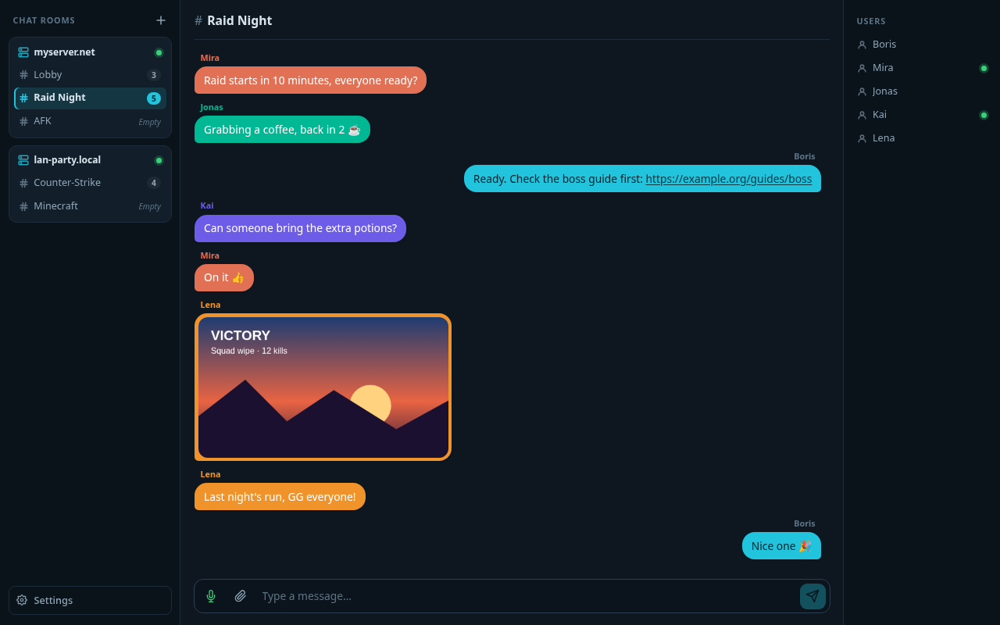
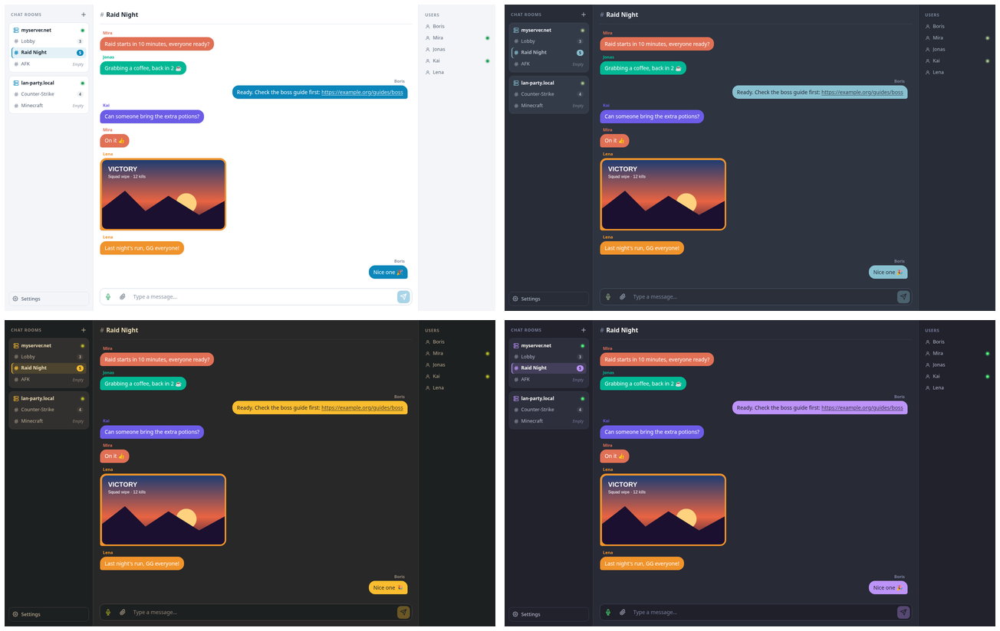
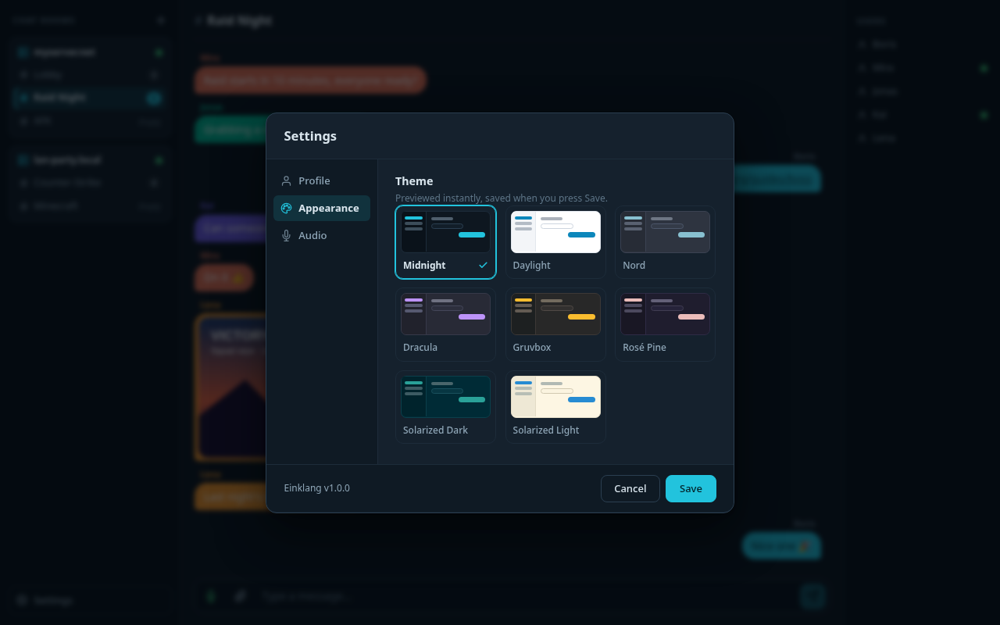

<p align="center">
  
</p>

<h1 align="center">Einklang</h1>

<p align="center">
  <b>The next generation voice chat for gamers.</b><br>
  Crystal-clear voice, rich text chat, your own server – free, light and private.
</p>

<p align="center">
  <a href="https://github.com/BorisBrock/einklang/actions/workflows/ci.yml"></a>
  <a href="https://github.com/BorisBrock/einklang/releases/latest"></a>
  <a href="https://hub.docker.com/r/borisbrock/einklang"></a>
  
  <a href="LICENSE"></a>
  
  
</p>

<p align="center">
  
</p>

> *Einklang* is German for *harmony* or *unison* – and the successor of the earlier *Reverb* project.

---

## ✨ Features

- **🎙️ Crystal-clear voice.** Low-latency Opus audio with an adaptive jitter buffer, packet-loss recovery and a smart voice-activity gate – your team hears you, not your fan.
- **💬 Rich text chat.** Persistent message history with clickable links and images. Just paste a screenshot to share it.
- **🏠 Many rooms, many servers.** Every server hosts as many rooms as you like, optionally password-protected. See who's online and who's talking at a glance.
- **🔒 Privacy first.** No account, no telemetry, no hidden data collection. Client and server are entirely under your control.
- **🪶 Featherweight.** A few megabytes on disk, tiny CPU and RAM usage. No Electron, no bloat – it stays out of your game's way.
- **🎨 Themes for every taste.** Midnight, Daylight, Nord, Dracula, Gruvbox, Rosé Pine and Solarized.
- **🐳 Host it in minutes.** One Docker command, one UDP port to forward. That's it.
- **💻 Cross-platform.** Windows and Linux today, macOS planned.
- **💚 Free and open source.** No ads, no subscription – GPLv3, forever.

<p align="center">
  
</p>

---

## 📦 Get Einklang

Download the latest version from the **[releases page](https://github.com/BorisBrock/einklang/releases/latest)**.

| | Client | Server |
|---|---|---|
| **Windows** | `EinklangClient_Portable_Windows_<version>.zip` – unzip and run | `EinklangServer_Portable_Windows_<version>.zip` – unzip and run |
| **Linux** | `Einklang-<version>-x86_64.AppImage` – `chmod +x` and run | Docker image [`borisbrock/einklang`](https://hub.docker.com/r/borisbrock/einklang) |

Start your own server with a single command:

```bash
docker run -d --network host -v /path/to/data:/data borisbrock/einklang
```

Then forward **UDP port 24816** in your router and invite your friends, ideally with a short **[join code](docs/HOSTING.md#inviting-friends-with-a-join-code)** like `56Go2jvoLWBH132` that holds the server, room and password. All the details are in the **[hosting guide](docs/HOSTING.md)**.

<p align="center">
  
</p>

---

## ☕ Support the project

If Einklang keeps your squad talking, you can buy me a coffee. Thank you!

<a href="https://www.buymeacoffee.com/borisbrock" target="_blank"></a>

---

## 📚 Documentation

- **[Hosting a server](docs/HOSTING.md)** – Docker, port forwarding and server configuration
- **[Client configuration](docs/CLIENT.md)** – all settings in `client-config.yml`
- **[Building from source](docs/BUILDING.md)** – dependencies, build, tests, debugging and releases
- **[Voice pipeline](docs/VOICE.md)** – how the audio gets from your mic to your friends' ears

## 📄 License

Einklang is free software, licensed under the [GNU General Public License v3](LICENSE) or (at your option) any later version.
